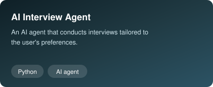
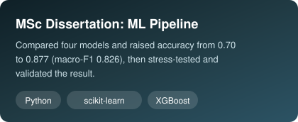
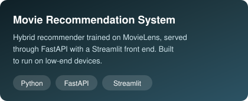
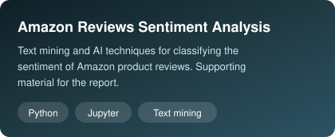
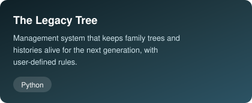
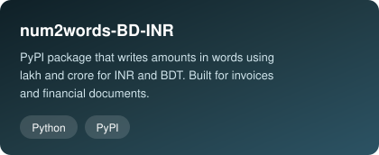
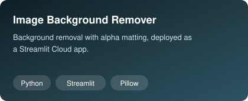

  

  

  
  
  
  

---

## About me

- **MSc Artificial Intelligence Technology**, Northumbria University London (2026)
- **3+ years as Senior Python (Odoo) Developer** at Metamorphosis Ltd, building custom ERP modules in Python and PostgreSQL
- Built **data pipelines and analytics dashboards** so operational data was ready for reporting and machine learning
- Dissertation: compared Random Forest, SVM, HistGradientBoosting and XGBoost, and raised accuracy from **0.70 to 0.877** (macro-F1 0.826) by diagnosing where the data could not separate classes
- Published **two Python packages** on PyPI
- I work directly with Finance and operations teams and explain technical trade-offs in plain language
- East London, UK
- **Open to:** machine learning, AI engineering, data science and data analytics roles

## Tech stack

  

  
  
  
  
  
  
  

## Experience

| Role | Where | When | What I did |
|---|---|---|---|
| **Senior Python (Odoo) Developer** | Metamorphosis Ltd | Jun 2022 – Aug 2025 | Custom ERP modules (Python, PostgreSQL), multi-stage approval and inventory automation, data pipelines and dashboards, CI/CD |
| **Data Analyst and Travel Coordinator** | Itinerary Holidays | Mar 2021 – Jan 2022 | Analysed operational datasets to support decisions, contributing to revenue growth of up to 30% |

**Education:** MSc Artificial Intelligence Technology, Northumbria University London (2025–2026) · BSc Computer Science and Engineering, Daffodil International University (2021, CGPA 3.53 / 4.00)

## Featured projects

<table>
  <tr>
    <td>
      
    </td>
    <td>
      
    </td>
  </tr>

  <tr>
    <td>
      
    </td>
    <td>
      
    </td>
  </tr>

  <tr>
    <td>
      
    </td>
    <td>
      
    </td>
    <td>
      
    </td>
  </tr>
</table>

<!-- ## Contributions

  <picture>
    <source media="(prefers-color-scheme: dark)" srcset="https://raw.githubusercontent.com/RifatAnwarRobin/RifatAnwarRobin/main/profile-3d-contrib/profile-night-rainbow.svg" />
    <source media="(prefers-color-scheme: light)" srcset="https://raw.githubusercontent.com/RifatAnwarRobin/RifatAnwarRobin/main/profile-3d-contrib/profile-gitblock.svg" />
    
  </picture>

-->